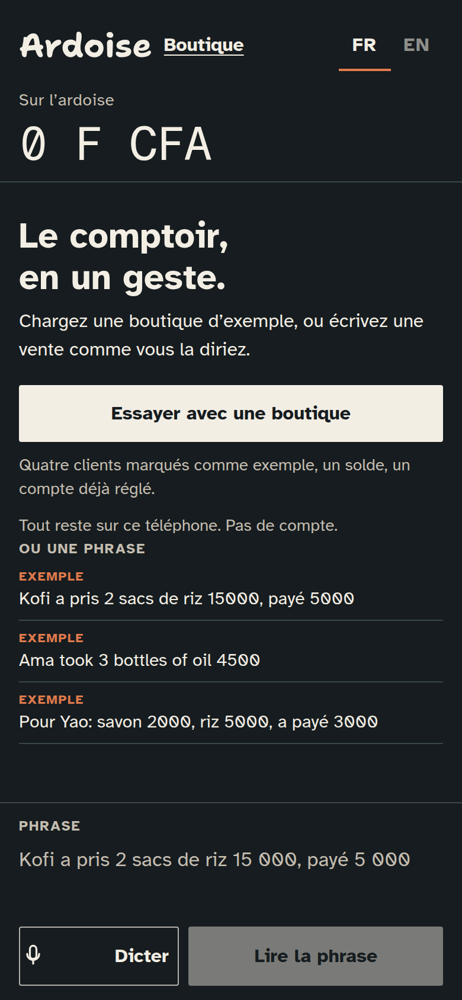
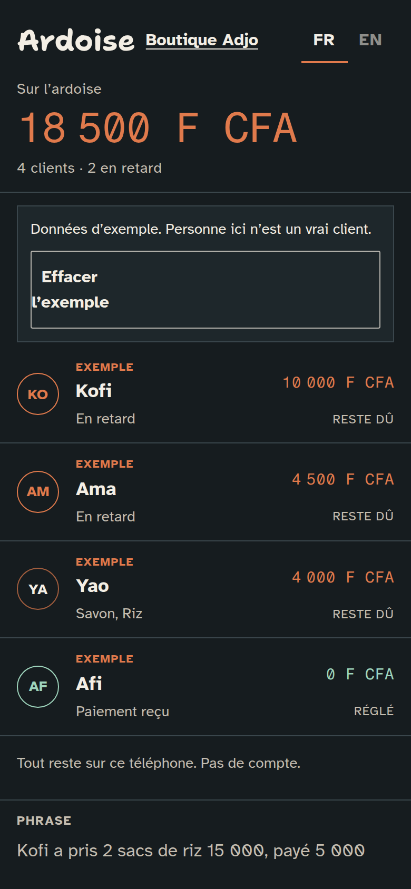
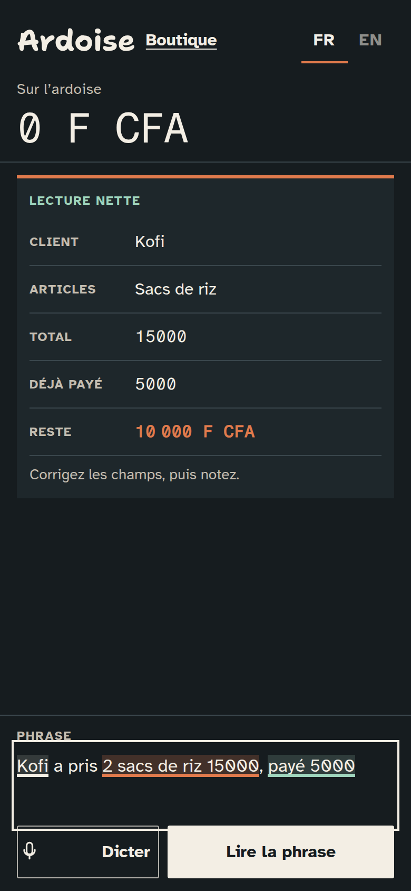
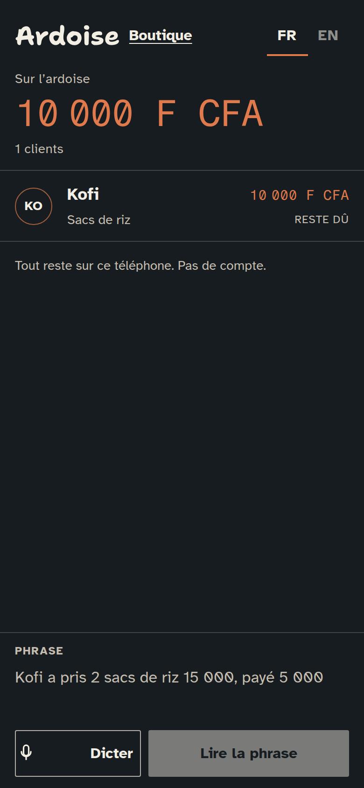
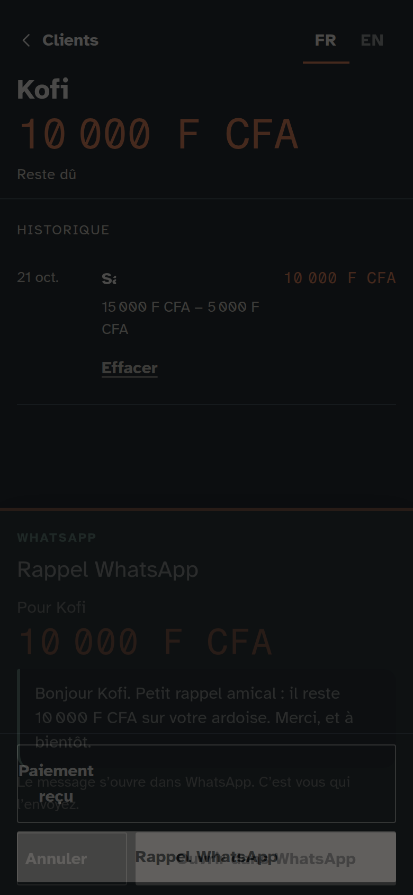
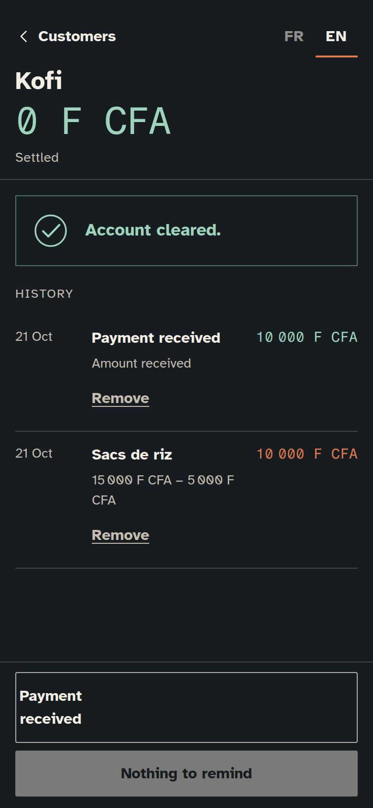

# Ardoise

A credit notebook for small shops. The shopkeeper types or dictates one sentence in French or English. Ardoise turns it into a customer, the items, the total, what was paid, and what is still due, in FCFA. One tap opens a polite reminder in WhatsApp. The notebook stays on the phone. There is no account.

**Live demo:** https://jeanpierre-web.github.io/ardoise/

The page is published from `main` by GitHub Actions. If that link 404s, GitHub Pages is not turned on yet. See [Publishing](#publishing).

Built for [Build With AI: Basics](https://learn-ai-basics.devpost.com/). The planning documents are [`devpost/scope.md`](devpost/scope.md), [`devpost/prd.md`](devpost/prd.md), and [`devpost/spec.md`](devpost/spec.md). The same three files are also at the repository root. The license is MIT.

The app has no users yet. The first screen offers a labelled example shop, and that sample can be cleared.

## Screenshots

Phone width, 390 pixels.













## Try it

The demo sentence:

```
Kofi a pris 2 sacs de riz 15000, payé 5000
```

As you type, Kofi, the rice, 15 000, and the 5 000 already paid are marked in the sentence. A card shows 10 000 still due. Correct anything, then note it. The figure on the slate counts to that balance. Open Kofi and tap the WhatsApp reminder: a preview appears first. You send the message yourself. **FR / EN** switches the labels and the reminder.

On an empty notebook, **Try with an example shop** loads four labelled sample customers. **Clear the example** removes them.

Dictation uses the browser’s speech recognition when it exists. Typing always works.

## Run it locally

Node.js 22 and npm.

```
npm install
npm test
npm run dev
```

Open the URL Vite prints. `npm run build` then `npm run preview` serves the production build.

No API key is required. To try a connected model on your own machine, copy `.env.example` to `.env.local` and set `VITE_LLM_BASE_URL`, `VITE_LLM_API_KEY`, and `VITE_LLM_MODEL`. Do not commit the key. The public site is built without those variables.

## How it was built

The repository started empty, with the MIT license. The Devpost Learn Skill Pack was installed with:

```
npx skills add challengepost/learn-ai-basics --all -y
```

The skills live in `.agents/skills`. Their templates are the shape of `devpost/scope.md`, `devpost/prd.md`, and `devpost/spec.md`, which were written from the project brief before the interface. The build checklist is `devpost/checklist.md`. A map of the code is `devpost/app-map.html`.

The app is Vite, React, and TypeScript. Tailwind supplies the reset and the font tokens. The layout is project CSS. The screen is the slate: charcoal `#161C1F`, chalk `#F3EEE4`, terracotta `#E07A4C` only for money still owed. Shantell Sans is the wordmark. Atkinson Hyperlegible is the interface. Fragment Mono is the tabular FCFA. The balance is the largest text on the slate. Customer rows carry initials, and overdue names come first. That direction comes from the brief (a chalk slate, a West African accent, not a generic app), from a balance that fills the screen, and from a person row with an initial. Mobbin’s search needed a paid plan and Refero needed a sign-in, so those libraries were not available while designing.

### The reader

The part that always runs is `parseEntry` in `src/lib/parseEntry.ts`. It is a set of rules for French and English shop sentences. It needs no key, no download, and no network. It also returns the character spans used to mark the sentence while it is typed. Unit tests cover the demo sentence, those spans, spaced amounts, `15,000` and `15.000`, several items, a payment on its own, the example shop, and the overdue sort.

Two optional re-readings can update the sheet if the shopkeeper has not started editing:

- The browser’s on-device `LanguageModel` API, only when the browser reports that a local model is already available.
- An OpenAI-compatible chat endpoint, only when the three environment variables above are set at build time.

If neither is there, or the call fails, the rule reading stays. The public demo does not depend on them.

Data is one JSON object in `localStorage`. A service worker caches the page so a later visit works offline. The first visit still needs a network to load the site.

## Tests

`npm test` runs Vitest. `scripts/smoke.mjs` opens the preview in Chrome at 390×844, loads the example shop and clears it, reads the demo sentence, saves it, reloads, checks the WhatsApp preview in French and English, notes a payment, and reloads while offline. It needs Playwright and a local Chrome, and it is not part of `npm test`.

## Publishing

`.github/workflows/pages.yml` builds with `GITHUB_PAGES=true` (so assets use `/ardoise/`) and deploys to GitHub Pages on every push to `main`.

If the live URL does not open, the owner needs to turn Pages on once:

1. Open the repository on GitHub.
2. **Settings → Pages**.
3. Under **Build and deployment**, set **Source** to **GitHub Actions**.

Then re-run the **Deploy GitHub Pages** workflow, or push an empty commit to `main`. The site should appear at https://jeanpierre-web.github.io/ardoise/.

## Hackathon notes

- Submission draft, with character counts: [`docs/devpost-submission.md`](docs/devpost-submission.md)
- Demo video script, under three minutes: [`docs/demo-script.md`](docs/demo-script.md)
- The video is not recorded yet. A live URL does not replace it.
- This repository does not submit anything to Devpost.
